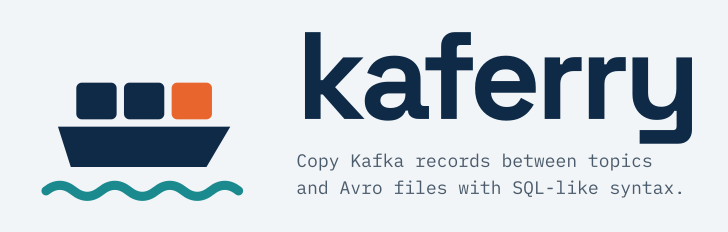

# Kaferry

<picture>
  <source media="(prefers-color-scheme: dark)" srcset="assets/kaferry-logo-dark.svg">
  
</picture>

[](https://github.com/pagrus7/kaferry/actions/workflows/ci.yml)
[](https://codecov.io/gh/pagrus7/kaferry)
[](https://github.com/pagrus7/kaferry/actions/workflows/qualification.yml)

Copy Kafka records between topics and CBOR files with one SQL-like statement.

Preserves raw keys, values, nulls, ordered headers and timestamps where possible; no transformations or Schema Registry access.

Implementation is AI-driven, using Codex and Claude Code under human direction.

## Install

[Download Kaferry](https://github.com/pagrus7/kaferry/releases/latest): Linux AMD64/ARM64 (glibc 2.34+) or macOS 14+ ARM64, with `SHA256SUMS`. Source builds need Go 1.26+, a C compiler and CGO; librdkafka is bundled.

Extract and run `kaferry`.

```sh
git clone https://github.com/pagrus7/kaferry.git
cd kaferry
make build
bin/kaferry --version
```

Tested with Apache Kafka 3.9.0.

## Known issues

On a coordinator timeout, Kafka-source startup closes its client so it can exit `1`; slow cleanup or other coordinator failures can still cause a [librdkafka crash](https://github.com/confluentinc/librdkafka/pull/5397) (signal exit). The worker copies nothing and leaves saved progress unchanged; rerun after coordinator recovery. Crash frequency in production is unknown. [Details](design/client-compatibility.md#known-issues).

## Quick start

Both topics must exist. Replace these addresses and add TLS/authentication. On one cluster, use a different destination topic.

**`connections.toml`:**

```toml
[connections.prod]
'bootstrap.servers' = 'source.example:9092'

[connections.backup]
'bootstrap.servers' = 'destination.example:9092'
```

**`copy.sql`:** copy the given hour of Kafka record timestamps.

```sql
INSERT INTO TOPIC 'orders@backup'
SELECT * FROM TOPIC 'orders@prod'
WHERE RECORD_TIMESTAMP >= TIMESTAMP '2026-10-01T09:00:00Z'
  AND RECORD_TIMESTAMP <  TIMESTAMP '2026-10-01T10:00:00Z'
OPTIONS (GROUP = 'orders-backfill');
```

`@alias` selects a connection. `GROUP` names the consumer group or file-source checkpoint.

```sh
bin/kaferry run --file copy.sql --config connections.toml
```

Each worker logs a JSON `copy summary` to stderr.

`-e` takes inline SQL; `-f -` reads stdin.

## More examples

**Archive from earliest and keep reading new records.** Create the output directory first.

```sql
INSERT INTO FILE cbor('/data/orders.cbor')
SELECT * FROM TOPIC 'orders@prod'
OPTIONS (GROUP = 'orders-archive', START = EARLIEST);
```

**Restore the last seven days.** Skip timestamps outside the destination's bounds.

```sql
INSERT INTO TOPIC 'orders@backup'
SELECT * FROM FILE cbor('/data/orders.cbor')
WHERE RECORD_TIMESTAMP >= NOW() - INTERVAL '7' DAY
OPTIONS (GROUP = 'orders-restore', ON_REJECTED_TIMESTAMP = SKIP);
```

**File to file:** [extract an inclusive time range](design/grammar.md#valid-examples) with `BETWEEN` and `GROUP = ONE_OFF`, which generates and logs a group name.

Filters use Kafka record time, not payload event time. Files read up to their size at startup; later appends wait for another run. [Full syntax](design/grammar.md).

## Connections

Use [librdkafka properties](https://docs.confluent.io/platform/current/clients/librdkafka/html/md_CONFIGURATION.html); quote dotted TOML keys and use string values. SQL overrides TOML. Topics without `@alias` use `default`.

PLAIN over TLS example:

```toml
[connections.prod]
'bootstrap.servers' = 'source.example:9093'
'security.protocol' = 'SASL_SSL'
'sasl.mechanism' = 'PLAIN'
'sasl.username' = 'copier'
'ssl.ca.location' = '/etc/kafka/ca.pem'
```

Prefix the statement to read its password from the environment:

```sql
WITH CONNECTION prod AS ('sasl.password' = ENV('PROD_PASSWORD'))
```

`ENV` works only in SQL and must be set. SQL can define connections. Logs redact properties; keep passwords out of literals and shell arguments. Settings that break copy guarantees are rejected.

Put optional limits and timeouts in TOML's `[worker]` table. [Settings and defaults](design/decisions.md#worker-settings).

## Before you run

- **Resume:** rerun the same query and `GROUP` to continue from saved progress. New windows or `CUTOFF` need a new group. `NOW()` is saved per partition or file. Expired offsets, deleted checkpoints or a different checkpoint directory can cause a fresh copy.
- **Window end:** without an end time, Kafka copies keep reading new records. With one, each partition stops at its first timestamp after `end + CUTOFF` (default one minute), or after catching up once that time passes. Records past the stop point can still be within the window and be missed, even if already present before the run. [Details](design/decisions.md#completion).
- **Delivery:** at least once. Crashing after writing but before saving progress, or rebalancing, can duplicate writes. Kafka sources read committed records.
- **Kafka output:** keep original keys; let the destination choose partitions. Default Java-compatible partitioning keeps equal non-null keys together with a fixed partition count. The destination controls timestamp type; `LogAppendTime` replaces timestamps. [Ordering details](design/decisions.md#kafka-output).
- **Payloads:** ensure bytes and Schema Registry IDs work at the destination. Old records may expire under destination retention.
- **Workers:** for topic-to-topic copies, give each process the same query and consumer group name, such as `GROUP = 'orders-backfill'`. Use explicit timestamps for the same window. With four workers and three topic partitions, Kafka may give one worker no partitions to read. For copies with an end time, that worker waits `worker.idle_exit` (30 seconds by default), then exits with code `3`. [Details](design/decisions.md#groups-and-workers).
- **Files:** one process per query on one machine, using a local filesystem with locks and hard links. For a new file-source job, run `mkdir -p ~/.kaferry/checkpoints`. To resume, use the existing checkpoint directory. Keep output and progress; losing either prevents resuming file output. Use a new group and output path to start over.
- **Permissions:** source topic READ and group READ for Kafka sources; destination WRITE for Kafka output. Kafka-source `ONE_OFF` needs the `kaferry-` group prefix authorized. [Details](design/client-compatibility.md#permissions).
- **Errors:** fail by default. Use `ON_ERROR = SKIP` or specific timestamp policies. Broker rejections, authentication errors and corruption still fail. [Skippable errors](design/decisions.md#errors).

Signals stop reading, drain writes for up to ten seconds and save progress; native calls can extend shutdown. JSON logs and final nonzero-exit messages go to stderr.

- `0`: this worker finished the work still assigned to it, or a Kafka copy without an end time stopped cleanly by signal.
- `1`: the copy failed, or was interrupted before its stopping rule.
- `2`: invalid command/configuration, or a conflict detected before reading records.
- `3`: for a copy with an end time, Kafka assigned this worker no partitions for `worker.idle_exit`. This does not say whether other workers finished.

Native aborts use signal exit status.

[Detailed behavior](design/decisions.md) · [File format](docs/file-format.md) · [Client limits and permissions](design/client-compatibility.md)

## Development

```sh
make check
make broker integration
make broker-down
```

Kafka tests need Docker. [Checks and reports](design/components.md#quality-indicators) · [Test targets](design/components.md#test-targets).

[MIT license](LICENSE); dependencies retain their licenses. [Security reporting](SECURITY.md).
