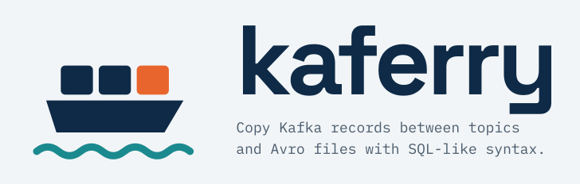

# Kaferry

<picture>
  <source media="(prefers-color-scheme: dark)" srcset="docs/assets/kaferry-logo-dark.svg">
  
</picture>

A lightweight command-line tool for copying Kafka records between topics and files using SQL-like statements.

[](https://github.com/pagrus7/kaferry/actions/workflows/ci.yml)
[](https://codecov.io/gh/pagrus7/kaferry)
[](https://github.com/pagrus7/kaferry/actions/workflows/qualification.yml)

## Examples

Prepare your [Kafka connections and destination topics](docs/usage.md#copy-between-kafka-topics). Save one statement as `copy.sql` and run:

```sh
kaferry run -c connections.toml -f copy.sql
```

**Topic to topic**

Copy current records and stop.

```sql
INSERT INTO TOPIC 'orders-copy@backup'
SELECT * FROM TOPIC 'orders@prod' WITH (GROUP = 'orders-copy-oct31')
WHERE RECORD_OFFSET < LATEST;
```

**Topic to file**

Save current records to disk and stop.

```sql
INSERT INTO ARCHIVE 'orders-archive'
SELECT * FROM TOPIC 'orders@prod' WITH (GROUP = 'orders-archive-oct31')
WHERE RECORD_OFFSET < LATEST;
```

**Time range**

Copy records from 09:00 to 10:00 UTC, inclusive, within the current backlog and stop.

```sql
INSERT INTO TOPIC 'orders-copy@backup'
SELECT * FROM TOPIC 'orders@prod' WITH (GROUP = 'orders-hour-oct01')
WHERE RECORD_OFFSET < LATEST
  AND RECORD_TIMESTAMP BETWEEN TIMESTAMP '2026-10-01T09:00:00Z'
                           AND TIMESTAMP '2026-10-01T10:00:00Z';
```

**File to topic**

Replay the archive into Kafka and stop.

```sql
INSERT INTO TOPIC 'orders-restored@backup'
SELECT * FROM ARCHIVE 'orders-archive' WITH (GROUP = 'orders-restore-oct31');
```

More examples: [Current records](docs/usage.md#copy-between-kafka-topics) · [Offset range](docs/usage.md#copy-an-offset-range) · [Selected partitions](docs/usage.md#copy-selected-partitions) · [Time range](docs/usage.md#copy-records-in-a-time-range) · [Tail new records](docs/usage.md#keep-copying-new-records) · [Archive and replay](docs/usage.md#archive-your-own-topic).

## Install

> **Warning:** Kaferry is pre-1.0. Releases may introduce breaking changes.

Homebrew:

```sh
brew install pagrus7/tap/kaferry
```

Go 1.26+:

```sh
CGO_ENABLED=0 go install github.com/pagrus7/kaferry/cmd/kaferry@latest
```

[Prebuilt binaries](https://github.com/pagrus7/kaferry/releases/latest) · [Installation details](docs/install.md).

## Docker quick start

Start Docker to try the bundled archive demo. No Kafka cluster or local Kaferry installation is needed.

```sh
docker run --rm \
  --mount source=kaferry-demo,target=/demo \
  --workdir /demo \
  ghcr.io/pagrus7/kaferry:latest run -c tutorial.toml -f copy.sql
```

With a fresh `kaferry-demo` volume, this copies three bundled sample records into `output` and saves progress. The `copy summary` on stderr includes these fields:

```json
{"msg":"copy summary","submitted":3,"confirmed":3}
```

The files remain after the container exits. Running the same command again resumes the same group and reports `submitted: 0` and `confirmed: 0`.

[Inspect results and reset the demo](docs/usage.md#first-copy-with-docker) · [Run without Docker](docs/usage.md#first-copy-without-kafka) · [Try Kafka locally](docs/usage.md#local-kafka-playground).

## Choosing a tool

| Tool | Use it for |
| --- | --- |
| Kaferry | Copy a time range to another topic or cluster, tail new records, capture records to disk, or replay an archive into Kafka. |
| MirrorMaker 2 | Maintain continuous replication between Kafka clusters, including topic configurations, ACLs and consumer-group offsets. |
| kcat | Inspect records and cluster metadata, or produce and consume records through shell pipelines. |

**Documentation:** [Index](docs/README.md) · [Settings and results](docs/reference.md).

**[Endurance test results](https://pagrus7.github.io/kaferry/)** — published runs, measurements and evidence.

**Project:** [Contributing](CONTRIBUTING.md) · [Security](SECURITY.md) · [MIT license](LICENSE); dependencies retain their licenses.
